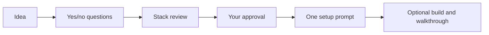

<div align="center">

# Student Project Starter

**From “I have an idea” to “I can run my project.”**

A patient AI mentor for students who have learned the tools<br>and want help choosing, connecting, and using them.

[English](README.md) · [繁體中文](README.zh-Hant.md)

[](LICENSE)
[](https://github.com/wilfredy/student-project-starter/actions/workflows/validate.yml)
[](skills/student-project-starter/SKILL.md)

[Install](#install) · [Try it](#try-it) · [Tech stack](#choose-only-what-you-need) · [Playbooks](#inside-the-skill)

</div>

---

You do not need to choose a database, collect API keys, or understand every tool before starting. Describe an idea. The skill asks short yes/no questions, recommends a small stack, and lets you review it before moving on.

**You get:** an explained stack, one portable setup prompt, and—if you want hands-on help—a runnable starter with private environment setup and a beginner handoff.



## Install

### Codex: paste this once

In Codex, ask:

```text
Use $skill-installer to install the skill from:
https://github.com/wilfredy/student-project-starter/tree/main/skills/student-project-starter
```

Then start a new chat and try the prompt below. If the skill does not appear, restart your app and check the installation folder. The whole `student-project-starter` folder is needed, including its references and sub-skills.

The installer uses your configured skills directory. Some Codex installations use `~/.codex/skills`; the current manual skill location is `~/.agents/skills`. Keep one installed copy to avoid duplicate names. See the [official Codex skill guide](https://developers.openai.com/codex/skills/).

<details>
<summary><strong>Manual installation · Codex or Cursor</strong></summary>

1. Download this repository using **Code → Download ZIP**, then extract it. Or clone it:

   ```bash
   git clone https://github.com/wilfredy/student-project-starter.git
   ```

2. Copy **`skills/student-project-starter`** into a skills directory. Copy the complete folder, not just `SKILL.md`:

   | Scope | Destination |
   | --- | --- |
   | Your user, macOS/Linux | `~/.agents/skills/student-project-starter/` |
   | Your user, Windows | `%USERPROFILE%\.agents\skills\student-project-starter\` |
   | One project | `<your-project>/.agents/skills/student-project-starter/` |

   Create the parent folders if needed. If you already have a copy, back up your edits and replace that copy instead of nesting a second folder inside it.

3. Open your coding assistant in the project. In Codex, invoke `$student-project-starter`. In Cursor, use `/student-project-starter` in Agent chat. See [Cursor's skill guide](https://cursor.com/docs/skills).

Updating: download or pull the newer repository, then replace the installed skill folder after preserving your custom changes. A normal folder copy does not update automatically. To uninstall, remove only that installed folder.

</details>

## Try it

**Start with an idea:**

```text
Use $student-project-starter. I want to build a study planner for my classmates.
Ask me yes/no questions first and explain your recommended stack before building.
```

**No idea yet:**

```text
Use $student-project-starter. I do not have a project idea yet.
Help me choose a small first project.
```

**Prefer Traditional Chinese:**

```text
使用 $student-project-starter，以繁體中文引導我。
我想做一個學生社團活動網站，請先問我簡單的是非題。
```

In Cursor, replace the opening `$student-project-starter` invocation with `/student-project-starter`. You can also describe the task in natural language and ask the assistant to use the installed skill.

### What the conversation feels like

> **You:** A website for my chess club's weekly meetup.
>
> **Mentor:** Do visitors need to sign in? **No.** Should meetup details appear in search? **Yes.**
>
> **Mentor:** Start with Next.js and a public event page. No database is needed for this first version. Do you approve the stack and scope?
>
> **You:** Yes.
>
> **Mentor:** Here is your single setup prompt. Would you like me to set up the project here?

You can revise the proposal, keep just the prompt, or approve local setup. Stack approval alone does not start creating files. Once you approve setup, the assistant builds the core action, helps configure only the needed settings, verifies what it can, and shows you how to get/open/run/edit the project.

No provider account or API key is needed for discovery. Building may need a compatible runtime; connecting a service may need an account or paid plan. The assistant checks the requirements for your chosen stack.

## Choose only what you need

| Your project needs… | Tool and role |
| --- | --- |
| A website, search-friendly page, or dashboard | **Next.js** — web UI and ordinary server routes |
| An installable iOS/Android app | **React Native + Expo** — mobile UI and native app workflow |
| Saved data, login, or live updates | **Supabase** — PostgreSQL, Auth, and optional Realtime |
| Little server administration | **Managed/serverless services** — only the clients and services the project needs; Vercel is a proposed web host |
| Scheduled jobs or multi-service workflows | **n8n** — coordinate APIs and automation steps |
| File or image storage | **Cloudflare R2** — object storage; consider Supabase Storage when simpler |
| A separate API or webhook backend | **Cloudflare Workers** — trusted server logic |
| A custom domain and DNS routing | **Cloudflare DNS** — domain records and routing configuration |
| Web billing or eligible physical purchases | **Stripe** — start with test-mode payments |
| Digital purchases inside a mobile app | **Apple In-App Purchase / Google Play Billing** — subject to current storefront rules |
| An event that asks a Grok Bot to do a task | **Grok Bot webhook** — trigger a defined Bot routine |
| An event that starts cloud coding or review work | **Cursor Automations webhook** — trigger a configured cloud agent task |

This is a selection guide, not a bundle to install. The skill checks current provider documentation when pricing, compatibility, commands, or payment rules affect the recommendation.

### Grok Bot and Cursor webhook examples

- **Grok Bot:** a submitted study question asks your Bot to draft a study plan.
- **Cursor Automations:** a bug report starts an analysis task for your repository.

Each has its own playbook, private URL/key settings, dummy event, local mock checks, and live-run handoff. An existing backend, n8n workflow, or small trusted script can send the event. The project keeps keys out of browsers, mobile bundles, chat, and Git. A successful HTTP trigger means the job started; the result still needs checking.

These are integrations with existing provider accounts. Installing this skill does not create a Bot, activate an automation, or grant repository access. See the [Grok Bot playbook](skills/student-project-starter/sub-skills/grokbot-webhook/SKILL.md) and [Cursor playbook](skills/student-project-starter/sub-skills/cursor-automation-webhook/SKILL.md).

## Inside the skill

| Playbook | When it is used |
| --- | --- |
| [nextjs-web](skills/student-project-starter/sub-skills/nextjs-web/SKILL.md) | Website, landing page, or dashboard |
| [expo-mobile](skills/student-project-starter/sub-skills/expo-mobile/SKILL.md) | Native mobile app |
| [web-and-mobile](skills/student-project-starter/sub-skills/web-and-mobile/SKILL.md) | Distinct web and mobile experiences needed now |
| [workers-api](skills/student-project-starter/sub-skills/workers-api/SKILL.md) | API or trusted mobile backend |
| [n8n-automation](skills/student-project-starter/sub-skills/n8n-automation/SKILL.md) | Automation without an app UI |
| [grokbot-webhook](skills/student-project-starter/sub-skills/grokbot-webhook/SKILL.md) | Grok Bot routine sender, standalone or added to an app |
| [cursor-automation-webhook](skills/student-project-starter/sub-skills/cursor-automation-webhook/SKILL.md) | Cursor cloud automation sender, standalone or added to an app |

The [main skill](skills/student-project-starter/SKILL.md) guides the conversation. Its [references](skills/student-project-starter/references/) hold discovery questions, stack decisions, the portable prompt, configuration, integration, and handoff guidance. Only relevant playbooks are loaded.

Generated projects receive a beginner `README.md`, `docs/project-plan.md`, `docs/setup-prompt.md`, example environment files when needed, and a working core action. Missing service credentials are clearly identified; a local demo is not described as a live integration.

## Testing and contributing

The original skill was exercised with seven dialogue scenarios and real Next.js and Workers starters. The webhook additions include documented local/mock and live verification criteria; **live Grok Bot and Cursor runs have not been tested with provider accounts**. See [test coverage and limitations](docs/TESTING.md).

To validate the repository locally with Python 3.11+:

```bash
python3 -m venv .venv
.venv/bin/python -m pip install -r requirements-dev.txt
.venv/bin/python scripts/validate.py
```

On Windows, use `.venv\Scripts\python.exe` in place of `.venv/bin/python`. Python is for repository validation; it is not a requirement for reading or invoking the skill.

Issues and pull requests are welcome. Keep both READMEs aligned, link new playbooks from the main skill, and describe what you actually tested. Use dummy data and keep credentials out of examples.

## License

[MIT](LICENSE). Students and teachers can use, adapt, and share the skill, including in commercial projects, while retaining the license notice. Provider accounts and services have their own terms.
