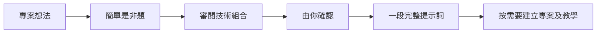

<div align="center">

# Student Project Starter

**由「我有個想法」，到「我識得啟動自己的專案」。**

給學過不同技術的學生，一位有耐性的 AI 專案導師。<br>幫你選擇合適工具、完成設定，並學會自己操作。

[English](README.md) · [繁體中文](README.zh-Hant.md)

[](LICENSE)
[](https://github.com/wilfredy/student-project-starter/actions/workflows/validate.yml)
[](skills/student-project-starter/SKILL.md)

[安裝](#安裝) · [開始使用](#開始使用) · [技術選擇](#只選專案真正需要的工具) · [設定指南](#技能內有甚麼)

</div>

---

開始前，你不用先選好資料庫、收集 API 金鑰，或了解所有工具。只要說出想法，技能就會用簡單的是非題釐清需求，建議精簡的技術組合，再讓你審閱及確認。

**你會得到：** 附有解釋的技術建議、一段可以複製使用的完整設定提示詞，以及按需要提供的專案建立協助、私人環境設定與入門教學。



## 安裝

### Codex：貼上這段即可

在 Codex 輸入：

```text
請使用 $skill-installer 安裝以下技能：
https://github.com/wilfredy/student-project-starter/tree/main/skills/student-project-starter
```

完成後開啟新的對話，試用下方的提示詞。如未見技能，請重新啟動應用程式，並檢查安裝位置。請保留整個 `student-project-starter` 資料夾，包括參考文件及子技能。

安裝器會使用你已設定的技能目錄。部分 Codex 安裝使用 `~/.codex/skills`；目前手動安裝的位置為 `~/.agents/skills`。保留一份安裝副本，避免同名技能重複出現。詳見 [Codex 官方技能指南](https://developers.openai.com/codex/skills/)。

<details>
<summary><strong>手動安裝 · Codex 或 Cursor</strong></summary>

1. 在這個儲存庫選擇 **Code → Download ZIP**，下載後解壓縮；或執行：

   ```bash
   git clone https://github.com/wilfredy/student-project-starter.git
   ```

2. 把 **`skills/student-project-starter`** 整個資料夾複製到技能目錄，並非只複製 `SKILL.md`：

   | 使用範圍 | 目標位置 |
   | --- | --- |
   | 個人使用，macOS／Linux | `~/.agents/skills/student-project-starter/` |
   | 個人使用，Windows | `%USERPROFILE%\.agents\skills\student-project-starter\` |
   | 只在一個專案使用 | `<你的專案>/.agents/skills/student-project-starter/` |

   如上層資料夾不存在，請先建立。如已有安裝副本，先備份自己的修改，再取代該副本；不要在舊資料夾內再放一層同名資料夾。

3. 在專案中開啟編程助手。Codex 使用 `$student-project-starter`；Cursor 在 Agent 對話中使用 `/student-project-starter`。詳見 [Cursor 官方技能指南](https://cursor.com/docs/skills)。

更新時，下載或拉取新版儲存庫，保留自己的修改後再取代已安裝的技能資料夾。一般複製的資料夾不會自動更新。移除時，只需刪除該安裝資料夾。

</details>

## 開始使用

**已有專案想法：**

```text
使用 $student-project-starter，以繁體中文引導我。
我想為同學做一個溫習計劃工具。
請先問我是非題，解釋建議的技術組合，等我確認後才建立專案。
```

**還未有想法：**

```text
使用 $student-project-starter。我暫時未有專案想法。
請幫我選一個適合作為第一個作品的小專案。
```

**只想取得設定提示詞：**

```text
使用 $student-project-starter，幫我規劃一個學生社團活動網站。
我確認技術組合後，請只提供一段完整設定提示詞，暫時不要建立檔案。
```

在 Cursor 使用時，請把開頭的 `$student-project-starter` 改為 `/student-project-starter`。你亦可以用自然語言描述需求，並請助手使用這個已安裝的技能。

### 對話會怎樣進行？

> **你：** 我想為棋藝學會做一個每週聚會網站。
>
> **導師：** 訪客需要登入嗎？**不需要。** 聚會資料需要被搜尋器找到嗎？**需要。**
>
> **導師：** 第一版建議用 Next.js 做公開活動頁，暫時不需要資料庫。你同意這個技術組合和範圍嗎？
>
> **你：** 同意。
>
> **導師：** 這是你的完整設定提示詞。需要我在這裏幫你建立專案嗎？

你可以要求修改建議、只保留提示詞，或同意助手建立專案。確認技術組合後，助手仍會先確認你是否需要實際建立檔案。獲得設定授權後，助手會完成核心功能、協助填寫必要設定、執行可行的驗證，並教你取得、開啟、執行及修改專案。

討論想法時不需要服務帳戶或 API 金鑰。建立專案可能需要合適的執行環境；連接服務可能需要帳戶或付費方案。助手會按你選定的技術檢查要求。

## 只選專案真正需要的工具

| 專案需要甚麼？ | 工具及用途 |
| --- | --- |
| 網站、適合搜尋器收錄的頁面或管理介面 | **Next.js** — 網頁介面及一般伺服器路由 |
| 可安裝的 iOS／Android App | **React Native + Expo** — 手機介面及原生 App 開發流程 |
| 儲存資料、登入或即時更新 | **Supabase** — PostgreSQL、Auth 及按需要使用的 Realtime |
| 減少伺服器管理工作 | **託管／Serverless 服務** — 只選需要的前端及服務；可考慮 Vercel 託管網站 |
| 排程或跨服務自動化 | **n8n** — 串連 API 及工作流程 |
| 檔案或圖片儲存 | **Cloudflare R2** — 物件儲存；較簡單的情況可考慮 Supabase Storage |
| 獨立 API 或 webhook 後端 | **Cloudflare Workers** — 可信任的伺服器邏輯 |
| 自訂網域與 DNS 路由 | **Cloudflare DNS** — 網域記錄及路由設定 |
| 網上收費或適用的實體商品交易 | **Stripe** — 先以測試模式處理付款 |
| 手機 App 內的數碼內容購買 | **Apple In-App Purchase／Google Play Billing** — 按最新商店及地區規則決定 |
| 有事件發生時，請 Grok Bot 處理任務 | **Grok Bot webhook** — 觸發已定義的 Bot 例行任務 |
| 有事件發生時，啟動雲端編程或檢查工作 | **Cursor Automations webhook** — 觸發已設定的雲端代理任務 |

這是選擇指南，並非每個專案都要安裝所有工具。當價格、相容性、指令或付款規則會影響建議時，技能會要求查閱最新官方文件。

### Grok Bot 與 Cursor webhook 例子

- **Grok Bot：** 收到溫習問題後，請 Bot 草擬溫習計劃。
- **Cursor Automations：** 收到錯誤報告後，啟動代理分析你的程式碼。

兩者各有設定指南、私人 URL／金鑰設定、測試事件、本機模擬驗證及正式連接步驟。現有後端、n8n 工作流程或簡單的可信任腳本都可以發送事件。金鑰會留在私人設定中，不會放進瀏覽器、手機程式、對話或 Git。HTTP 觸發成功只代表工作已開始，仍需檢查實際結果。

這些功能需要對應的服務帳戶。安裝此技能不會自動建立 Bot、啟用自動化或授予儲存庫權限。詳見 [Grok Bot 指南](skills/student-project-starter/sub-skills/grokbot-webhook/SKILL.md)及 [Cursor 指南](skills/student-project-starter/sub-skills/cursor-automation-webhook/SKILL.md)。

## 技能內有甚麼？

| 設定指南 | 適用情況 |
| --- | --- |
| [nextjs-web](skills/student-project-starter/sub-skills/nextjs-web/SKILL.md) | 網站、介紹頁或管理介面 |
| [expo-mobile](skills/student-project-starter/sub-skills/expo-mobile/SKILL.md) | 原生手機 App |
| [web-and-mobile](skills/student-project-starter/sub-skills/web-and-mobile/SKILL.md) | 現階段同時需要不同的網站及手機體驗 |
| [workers-api](skills/student-project-starter/sub-skills/workers-api/SKILL.md) | API 或手機 App 的可信任後端 |
| [n8n-automation](skills/student-project-starter/sub-skills/n8n-automation/SKILL.md) | 不需要 App 介面的自動化 |
| [grokbot-webhook](skills/student-project-starter/sub-skills/grokbot-webhook/SKILL.md) | 獨立或接到現有 App 的 Grok Bot 任務發送端 |
| [cursor-automation-webhook](skills/student-project-starter/sub-skills/cursor-automation-webhook/SKILL.md) | 獨立或接到現有 App 的 Cursor 雲端任務發送端 |

[主技能](skills/student-project-starter/SKILL.md)負責引導對話；[參考文件](skills/student-project-starter/references/)包含探索問題、技術選擇、完整提示詞、環境變數、服務整合及交接教學。助手只會讀取與當前專案有關的指南。

建立的專案會包括入門 `README.md`、`docs/project-plan.md`、`docs/setup-prompt.md`、按需要提供的環境設定範本，以及可操作的核心功能。如尚欠服務金鑰，助手會清楚列明；本機示範不會被當成已正式連接的服務。

## 測試與參與改進

原版技能已完成七個對話情境測試，並實際建立及驗證 Next.js 與 Workers 入門專案。新增的 webhook 指南列明本機模擬及正式連接的驗證條件；**尚未使用服務帳戶測試真實 Grok Bot 或 Cursor 任務**。詳見[測試範圍與限制](docs/TESTING.md)。

使用 Python 3.11 或以上版本，可在儲存庫目錄驗證：

```bash
python3 -m venv .venv
.venv/bin/python -m pip install -r requirements-dev.txt
.venv/bin/python scripts/validate.py
```

Windows 請以 `.venv\Scripts\python.exe` 取代 `.venv/bin/python`。Python 用於儲存庫驗證；閱讀或啟用技能本身不需要 Python。

歡迎提出 Issue 或 Pull Request。請同步更新中英文 README，把新指南連結至主技能，並清楚說明實際測試內容。例子請使用虛構資料，不要提交任何金鑰。

## 授權

採用 [MIT 授權](LICENSE)。學生及老師可使用、修改及分享此技能，包括用於商業專案，並保留授權聲明。各服務帳戶及平台另有其使用條款。
